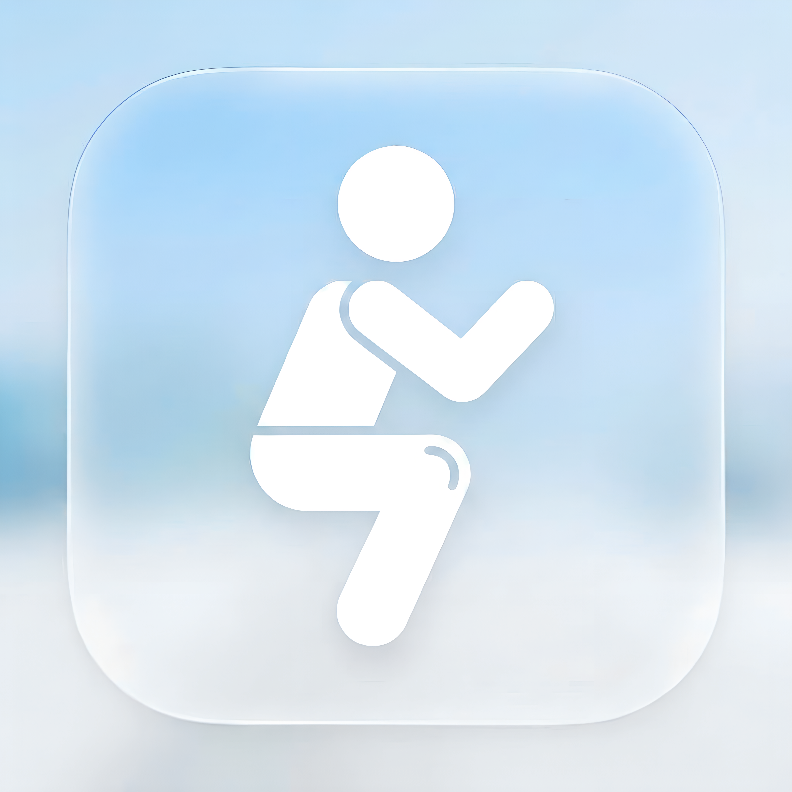
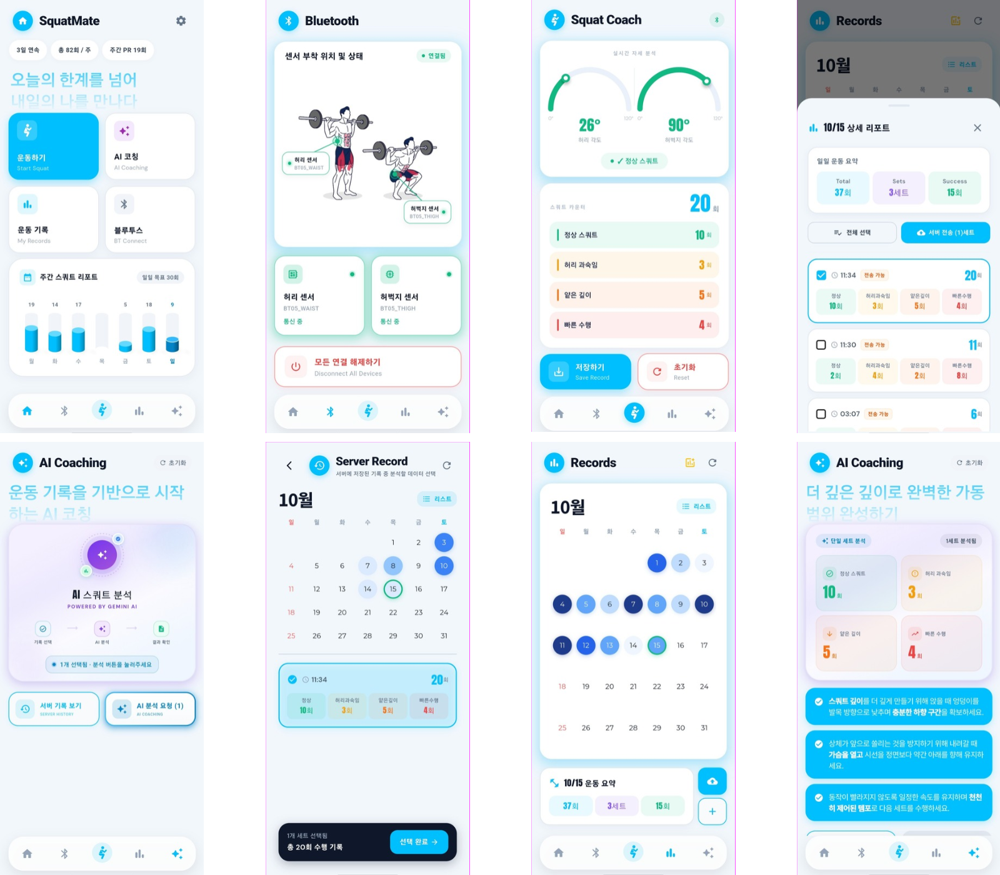
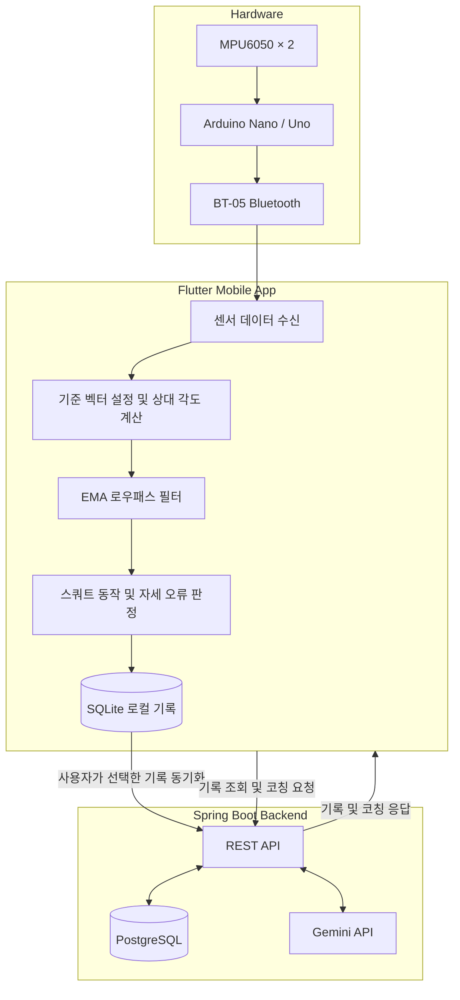

# SquatMate

**실시간 센서 데이터와 AI 코칭을 활용한 스마트 스쿼트 운동 관리 서비스**

SquatMate는 신체에 부착한 센서를 통해 스쿼트 동작을 측정하고, 운동 기록과 자세 오류를 분석하여 AI 기반 코칭을 제공하는 개인 프로젝트입니다.

Flutter 기반 모바일 애플리케이션과 Spring Boot 서버, Arduino 및 MPU6050 센서를 연동하여 운동 데이터 수집부터 기록 관리, AI 피드백 제공까지의 과정을 구현했습니다.

## 📌 Project Overview

- **개발 기간:** 2026.06 ~ 2026.10
- **프로젝트 유형:** 개인 프로젝트
- **담당 역할:** 모바일 앱, 백엔드 서버, 하드웨어 연동 및 개발
- **주요 목표:** 센서 기반 스쿼트 동작 분석과 AI 맞춤형 운동 피드백 제공

## 🛠 Tech Stack

### Mobile
- Flutter
- Dart
- Bluetooth 기반 센서 데이터 수신
- SQLite 기반 로컬 운동 기록 관리

### Backend
- Java 21
- Spring Boot
- REST API
- JWT 기반 사용자 인증
- Gemini API 기반 AI 코칭

### Database & Deployment
- PostgreSQL
- Supabase
- Render

### Hardware
- Arduino Nano × 1
- Arduino Uno × 1
- MPU6050 × 2
- BT-05 Bluetooth 모듈 × 2

자세한 기술 스택과 각 기술을 선정한 이유는 [Tech Stack Documentation](docs/tech-stack.md)에서 확인할 수 있습니다.

## ✨ Key Features

### 1. 사용자 인증 및 데이터 관리
- 회원가입 및 로그인
- JWT 기반 사용자 인증
- 사용자별 운동 기록 관리

### 2. 실시간 스쿼트 동작 분석
- 허리와 허벅지에 부착한 MPU6050 센서 데이터 수신
- 운동 시작 시 기준 자세의 벡터를 저장하고, 측정 중인 현재 벡터와 비교하여 상대 각도 계산
- EMA 기반 로우패스 필터를 적용한 각도 데이터로 스쿼트 동작 판정
- 허리 각도, 허벅지 각도, 수행 시간을 기준으로 오류 분류

### 3. 운동 기록 및 통계
- 운동 수행 결과와 자세 오류 기록
- SQLite에 운동 기록을 우선 저장
- 사용자가 선택한 기록을 서버에 전송
- 누적 운동 기록 및 기간별 통계 조회

### 4. AI 기반 운동 코칭
- 단일 운동 기록에 대한 AI 코칭
- 여러 운동 기록을 종합한 AI 코칭

## 📱 App Screenshots

SquatMate의 주요 화면과 기능을 한눈에 확인할 수 있습니다.



[전체 앱 스크린샷 폴더 보기](docs/images/)

## 🏗 System Architecture

SquatMate의 전체 데이터 처리 흐름은 다음과 같습니다.



시스템을 구성하는 주요 컴포넌트와 각 요소의 역할 및 연결 관계는
[Architecture Documentation](docs/architecture.md)에서 확인할 수 있습니다.

### Data Flow

1. 허리와 허벅지에 배치한 MPU6050 센서가 각각 3축 가속도 데이터를 측정합니다.
2. 각 센서 데이터는 Arduino 보드를 거쳐 BT-05 Bluetooth 모듈을 통해 Flutter 앱으로 전달됩니다.
3. 앱은 운동 시작 시 기준 자세의 벡터를 저장하고, 측정 중인 현재 벡터와 비교하여 상대 각도를 계산합니다.
4. 계산된 각도 데이터에 EMA 기반 로우패스 필터를 적용한 뒤, 스쿼트 횟수와 자세 오류를 판정합니다.
5. 운동 기록은 SQLite에 먼저 저장됩니다.
6. 사용자가 전송할 기록을 선택하면 앱이 REST API를 통해 서버에 전송합니다.
7. 서버는 사용자별 기록을 PostgreSQL에 저장하고, 기록 조회 및 AI 코칭 요청을 처리합니다.

### Hardware Overview

- 허리 측정 모듈: Arduino Uno + MPU6050 + BT-05
- 허벅지 측정 모듈: Arduino Nano + MPU6050 + BT-05

하드웨어 구성, 센서 데이터 수집 및 Bluetooth 통신 방식에 대한 자세한 내용은 [Hardware Configuration](docs/hardware-configuration.md)에서 확인할 수 있습니다.

### Relative Angle Calculation

앱은 운동 시작 시 기준 자세의 벡터를 저장하고, 측정 중인 현재 가속도 벡터와 비교하여 상대 각도를 계산합니다. 두 벡터의 내적을 이용해 각도를 구하며, 계산 결과는 도(degree) 단위로 변환합니다.

두 벡터 사이의 상대 각도는 다음과 같이 계산합니다.

$$
\theta = \cos^{-1}\left(
\frac{\vec{A}\cdot\vec{B}}
{|\vec{A}||\vec{B}|}
\right)
\times \frac{180}{\pi}
$$

- $\vec{A}$: 운동 시작 시 저장한 기준 자세의 벡터
- $\vec{B}$: 현재 측정 중인 가속도 벡터
- $\theta$: 두 벡터 사이의 상대 각도

계산된 각도는 기준 자세에 대한 상대적인 기울기를 나타내며, 실제 무릎 관절 각도를 직접 측정한 값은 아닙니다. 또한 가속도 센서는 움직임 중 동적 가속도의 영향을 받을 수 있으므로, 계산된 각도가 실제 신체 부위의 방향과 항상 일치하는 것은 아닙니다.

### EMA-based Low-pass Filter

센서 데이터에는 순간적인 노이즈와 각도 변동이 발생할 수 있습니다. 이를 완화하기 위해 EMA(Exponential Moving Average) 기반 로우패스 필터를 적용했습니다.

이전 필터링 값과 현재 측정값을 가중 평균하여 각도 데이터를 보정합니다.

$$
Filtered_t = 0.85 \times Filtered_{t-1} + 0.15 \times Raw_t
$$

- $Filtered_t$: 현재 필터링된 각도
- $Filtered_{t-1}$: 이전 필터링된 각도
- $Raw_t$: 현재 측정된 각도

필터링된 각도 데이터는 스쿼트 횟수와 자세 오류를 판정하는 데 사용됩니다.

## ⚙️ Squat Analysis Logic

SquatMate는 허벅지 각도를 이용해 한 번의 스쿼트 동작을 구분하고, 허리 각도·최대 허벅지 각도·수행 시간을 각각 검사합니다.

| 판정 항목 | 정상 조건 | 오류 조건 |
|---|---|---|
| 동작 시작 | 허벅지 각도 40° 초과 시 시작 감지 | — |
| 동작 종료 | 허벅지 각도 15° 이하로 돌아오면 한 회 정산 | — |
| 허리 각도 | 40° 이하 | 40° 초과 |
| 최대 허벅지 각도 | 85° 이상 | 85° 미만 |
| 한 회 수행 시간 | 3초 이상 | 3초 미만 |

각 오류 조건은 독립적으로 검사합니다. 따라서 한 번의 스쿼트에서 허리 각도, 깊이, 수행 시간 오류가 동시에 기록될 수 있습니다.

> **판정 기준의 범위:** 위 각도는 프로젝트에서 설정한 초기 기준이며 모든 사용자의 신체 특성과 스쿼트 자세를 절대적으로 정의하는 값은 아닙니다. 신체 비율, 유연성, 센서 부착 상태에 따라 측정 결과가 달라질 수 있습니다.

## 🧠 Technical Decisions

SquatMate 개발 과정에서 마주한 기술적 문제와 설계 선택, 이를 해결하기 위한 의사결정 과정을 정리했습니다.

- 데이터베이스 통합 및 데이터 관리 구조
- 실시간 센서 분석과 데이터 처리 방식
- AI API 호출 최적화 및 센서 노이즈 개선
- 하드웨어 프로토타입의 한계를 고려한 설계

자세한 기술적 의사결정 과정과 각 설계 선택의 배경은 [Technical Decisions](docs/tech-decisions.md)에서 확인할 수 있습니다.

## 🧪 Testing & Validation

### 1. 실제 센서 기반 동작 테스트

허벅지와 허리 위치에 센서를 배치하고 실제 스쿼트 동작을 수행하며 실시간 각도 UI와 판정 결과를 확인했습니다. 테스트 당시에는 센서를 손으로 잡거나 다른 사람이 잡아주는 방식으로 신체 부위에 배치하여 실제 착용 상황을 가정하고 측정했습니다.

스쿼트 동작에 관한 자료를 참고하고 직접 동작을 수행하며 허리 각도 40°, 최대 허벅지 각도 85°를 초기 판정 기준으로 설정했습니다. 해당 기준은 자료의 각도 수치를 그대로 적용한 것이 아니라, 프로젝트의 센서 측정 방식과 테스트 결과를 바탕으로 정한 값입니다.

테스트 과정에서 신체 비율과 유연성에 따라 동일한 각도 기준을 만족하기 어려운 정도가 사람마다 다를 수 있음을 확인했습니다. 이에 해당 기준을 모든 사용자에게 적용되는 절대적인 자세 평가 기준이 아닌, 초보자가 기본적인 동작 범위를 인식하도록 돕기 위한 초기 판정 기준으로 설정했습니다.

### 2. 필터 적용 및 오류 판정 테스트

초기 구현에서는 필터 없이 센서 각도를 이용해 스쿼트 동작을 판정했습니다. 그러나 정지 상태에서도 각도 값이 흔들리면서 스쿼트 깊이를 잘못 판정하거나 동작을 안정적으로 인식하지 못하는 문제가 발생했습니다.

이를 개선하기 위해 EMA 기반 로우패스 필터를 적용하고, 적용 전후의 각도 변동과 판정 결과를 비교했습니다. 직접 테스트한 결과 필터 적용 후 순간적인 각도 변동이 완화되고 잘못된 오류 판정이 크게 줄어드는 것을 확인했습니다.

또한 허리 과숙임, 얕은 깊이, 빠른 수행 등의 오류를 의도적으로 발생시켜 각 오류가 유형별로 구분되어 집계되는지 확인했습니다. 여러 오류 조건이 동시에 발생하는 경우에도 각각의 오류가 독립적으로 기록되는지 함께 검증했습니다.

### 3. 기록부터 AI 코칭까지 통합 테스트

실제 운동 수행 후 생성된 기록이 로컬 SQLite 데이터베이스에 정상적으로 저장되는지 확인했습니다. 이후 사용자가 전송할 기록을 선택하여 서버로 전송하고, PostgreSQL에 저장된 기록을 조회하는 과정까지 테스트했습니다.

또한 서버에 저장된 운동 기록을 바탕으로 개별 AI 코칭을 요청하고 결과를 받아오는 과정을 확인했습니다. 여러 운동 기록을 선택하여 종합 코칭을 요청하는 과정도 테스트하여 운동 기록 생성부터 서버 동기화, AI 코칭까지 이어지는 전체 흐름이 정상적으로 동작하는지 검증했습니다.

> 본 테스트는 실제 센서와 앱을 이용한 기능 검증입니다. 정량적인 정확도 측정이나 다양한 사용자 집단을 대상으로 한 임상적 검증을 수행한 것은 아닙니다.

## 🚀 Try SquatMate

배포된 Android 테스트 버전을 설치하여 SquatMate의 주요 기능을 직접 체험할 수 있습니다.

1. [GitHub Releases에서 APK 다운로드](https://github.com/LHY-AImaster/squat_project/releases)
2. Android 기기에 APK를 설치하고 앱을 실행합니다.
3. 회원가입 후 로그인합니다.
4. 운동 기록, 통계 및 AI 코칭 기능을 확인합니다.

### 참고 사항

- 현재 서버는 Render 무료 플랜으로 운영됩니다.
- 일정 시간 요청이 없으면 서버가 중지될 수 있으며, 첫 요청 시 재가동으로 인해 응답이 지연될 수 있습니다.
- 회원가입 요청이 바로 처리되지 않으면 잠시 기다린 뒤 다시 시도해 주세요.
- 센서 기반 스쿼트 측정 기능을 체험하려면 하드웨어가 필요합니다.
- 이 버전은 Android APK이며, iOS용 설치 파일은 제공하지 않습니다.

## 🧑‍💻 Run Locally

SquatMate를 로컬 개발 환경에서 실행하기 위한 설치 및 설정 방법은 아래 문서에서 확인할 수 있습니다.

- [Local Setup Guide](docs/local-setup.md)

## ☁️ Cloud Deployment

SquatMate의 클라우드 배포 환경 구성과 Android APK 빌드 과정은 아래 문서에서 확인할 수 있습니다.

- [Deployment Guide](docs/deployment.md)

## 📁 Project Structure

아래는 저장소의 주요 구성 요소를 이해하기 위한 개요입니다.

```text
squat_project/
├── app/        # Flutter 모바일 애플리케이션
├── server/     # Spring Boot 백엔드 서버
└── firmware/   # Arduino 센서 및 Bluetooth 펌웨어
```

## 🔍 Key Source Files

**Flutter Application**
- [Bluetooth 센서 데이터 수신](https://github.com/LHY-AImaster/squat_project/blob/main/app/lib/services/my_bluetooth_service.dart)
- [스쿼트 분석 서비스](https://github.com/LHY-AImaster/squat_project/blob/main/app/lib/services/squat_analyzer_service.dart)
- [운동 상태 및 기록 관리](https://github.com/LHY-AImaster/squat_project/blob/main/app/lib/providers/squat_provider.dart)

**Spring Boot Backend**
- [백엔드 API 컨트롤러](https://github.com/LHY-AImaster/squat_project/blob/main/server/src/main/java/com/squat/server/controller/SquatWorkoutController.java)
- [AI 코칭 서비스](https://github.com/LHY-AImaster/squat_project/blob/main/server/src/main/java/com/squat/server/service/SquatCoachingService.java)

**Arduino Firmware**
- [Arduino Nano 펌웨어](https://github.com/LHY-AImaster/squat_project/blob/main/firmware/Separate_Nano.ino)
- [Arduino Uno 펌웨어](https://github.com/LHY-AImaster/squat_project/blob/main/firmware/Separate_UNO.ino)